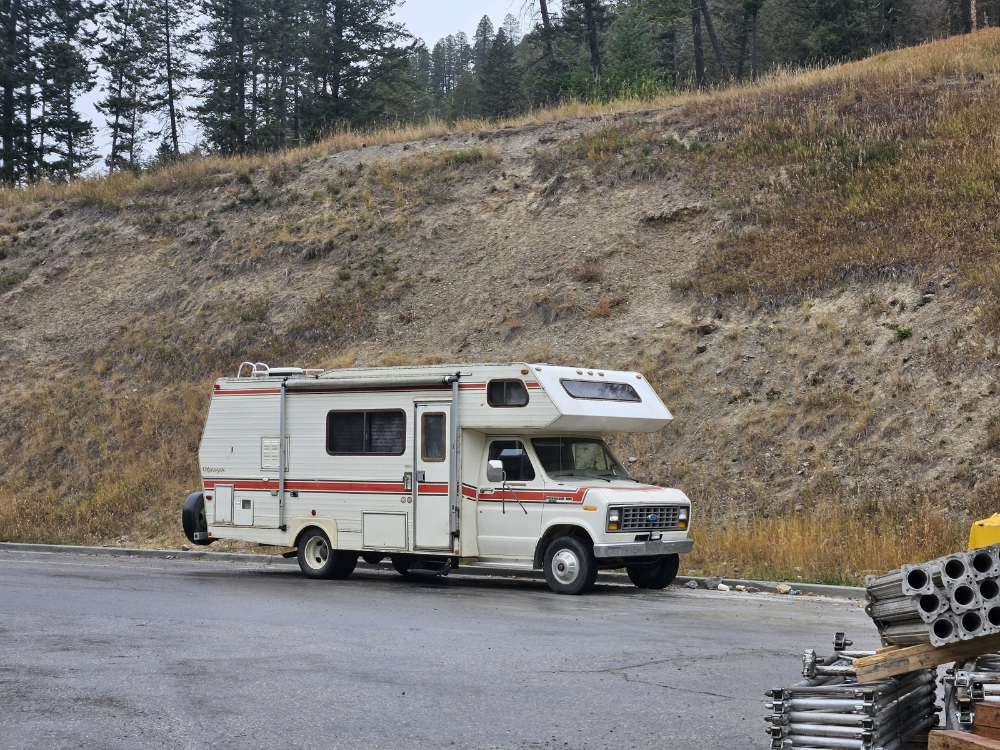
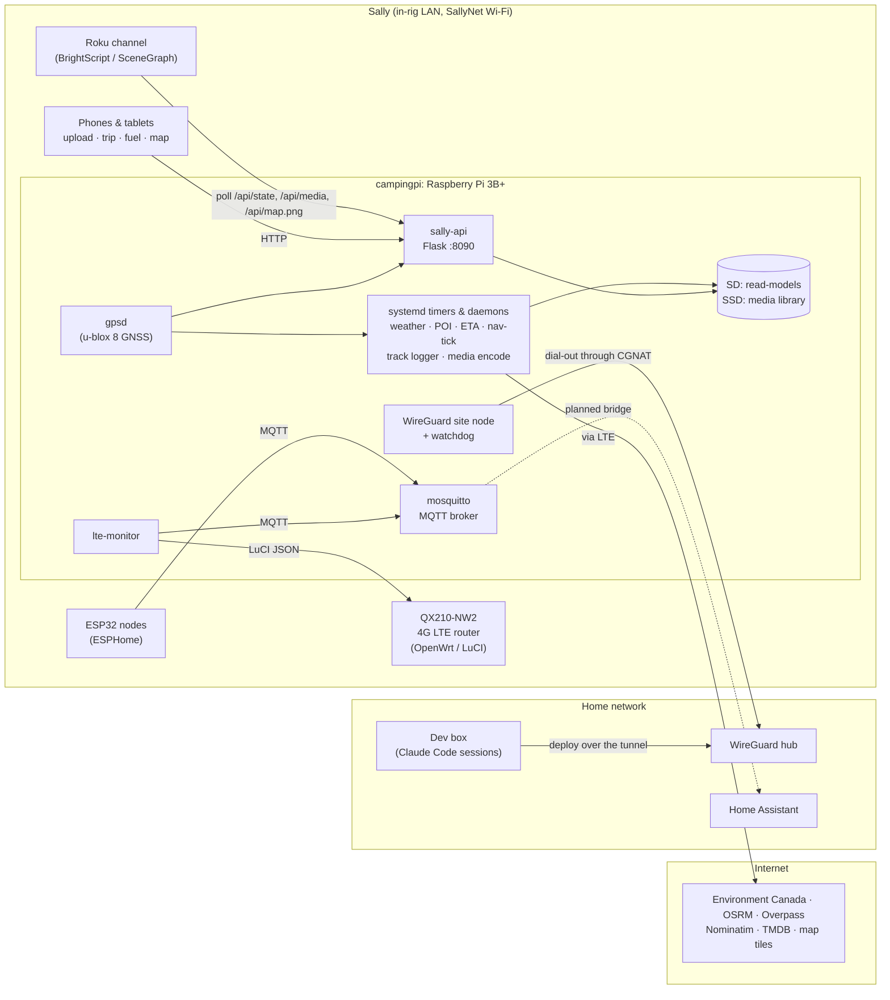

# SallyNet

[](https://github.com/jimidarke/SallyNet/actions/workflows/ci.yml)
[](LICENSE)

The tech stack (and the logbook) for **Sally**, a 1985 Ford E-350 Okanagan motorhome that our
family takes camping. SallyNet turns a 40-year-old RV into a small rolling network: a cellular
router, a Raspberry Pi running the backend services, a Roku running a custom dashboard channel,
GPS, home-media playback, an ambient map, and a growing set of ESP32 sensors. A phone-home
WireGuard tunnel makes all of it reachable from anywhere.



It's a hobby project, but it's built the way I'd build production software. There's a frozen API
contract, unit tests and CI, systemd units, idempotent deploy scripts, written post-mortems, and a
documented migration plan. Most of the work was done pairing with
[Claude Code](https://claude.com/claude-code) (see [Built with Claude Code](#built-with-claude-code)).

## What it does

- **Glass dashboard on the TV.** A sideloaded Roku channel (BrightScript + SceneGraph) polls the
  backend and renders Home, Drive, Camp, Map, Media and Trips screens. The channel only displays
  data and auto-switches screens based on GPS mode (driving / camping / parked / at home).
- **`sally-api` backend.** A Flask service on the Pi (`:8090`) that serves `/api/state` (GPS,
  mode, trip, fuel, weather, alerts), the media catalog with HTTP Range streaming, and phone
  web pages on the in-rig Wi-Fi for guest photo upload (QR code), trip entry, fuel logging,
  waypoints and the map. The contract is frozen and versioned, and changes to it are
  additive only: [`subsystems/media/api-contract.md`](subsystems/media/api-contract.md).
- **Home-media pipeline.** Filesystem-queue ingest with sha256 dedup, atomic publish and
  rollback, then an encode-once H.264 profile. Media without embedded GPS is geotagged from a
  GPX breadcrumb log. Movies and TV get TMDB poster and genre matching with an offline
  frame-grab fallback.
- **Ambient map.** Server-composited PNG: basemap tiles (disk-cached, with a circuit breaker
  and Retry-After handling), breadcrumb trail, POIs from Overpass, waypoints and favourites, and
  a GPS-loss safety overlay.
- **Out-of-band workers.** systemd timers handle OSRM road ETA, Environment Canada weather for
  the nearest station, POI snapshots, and a GPS nav-tick daemon. `/api/state` itself stays
  network-free, so it degrades gracefully in dead zones.
- **Networking and remote access.** The QX210 LTE router sits behind carrier CGNAT, so the Pi
  dials *out* to a WireGuard hub at home and NETMAPs the whole van LAN into the home network.
  A watchdog timer recovers from boot races and dynamic-DNS changes. An LTE monitor polls the
  router's LuCI API and publishes signal and bandwidth to MQTT, with Home Assistant discovery.
- **Sensors.** ESPHome nodes publish over MQTT, starting with a cabin temperature/humidity
  node. The full ESP32 fleet plan is in [`subsystems/telemetry/esp-fleet.md`](subsystems/telemetry/esp-fleet.md).

## Architecture



**Planned: Pi to mini-PC migration.** The Pi 3B+ is a stopgap host. The always-on services
(sally-api, gpsd, MQTT, the media library, and later telemetry and audio) are slated to move to an
Intel N100 mini-PC, and the Pi goes back to being a RetroPie appliance. The Roku only talks HTTP to
the frozen contract, so the switch is an `apiBase` repoint with no channel code changes. Rationale
and order of work: [`subsystems/compute/README.md`](subsystems/compute/README.md).

## Repository layout

```
services/sally-api/   Flask backend + unit tests (pytest / unittest)
roku-channel/         Roku channel: BrighterScript toolchain, SceneGraph screens, deploy script
scripts/              Media pipeline, workers, deploy scripts (bash + Python)
configs/              systemd units, ESPHome YAML, env templates, organised by subsystem
subsystems/           One folder per functional area (network, media, gps, power, telemetry, ...)
                      with a README, status and the next concrete action
docs/                 About Sally, current inventory, network diagram, mechanics, fuel log
.claude/skills/       Repo-local Claude Code skills (ops runbooks, see below)
CLAUDE.md             Project guidance for Claude Code (plus roku-channel/CLAUDE.md)
VERSION.txt           SemVer + changelog (tags v0.3.0 to v0.8.0)
```

## Running the tests

The backend tests run off the Pi with no hardware, network, or ffmpeg needed:

```bash
cd services/sally-api
python3 -m pip install -r requirements.txt pytest
python3 -m pytest -q          # or: python3 -m unittest
```

CI runs the same suite on every push and pull request ([`.github/workflows/ci.yml`](.github/workflows/ci.yml)).
The Roku channel lints with BrighterScript: `cd roku-channel/channel && npm install && npm run lint`.

## Built with Claude Code

This repo is also a worked example of AI-assisted engineering on a real, messy, hardware-bound
project. Every commit carries a `Co-Authored-By: Claude …` trailer, so `git log` shows which work
was paired.

- **[`CLAUDE.md`](CLAUDE.md) and [`roku-channel/CLAUDE.md`](roku-channel/CLAUDE.md)** hold the
  standing project context: the architecture rules ("Roku is glass", the frozen API), conventions,
  hardware facts, file paths on each device, the read-only propane rule, and where credentials
  live. With these, a new session starts with that context already loaded instead of
  rediscovering it.
- **[`.claude/skills/`](.claude/skills/)** has three repo-local skills that encode operational
  runbooks:
  - `sallynet-pi-ops`: deploying to and maintaining the Pi. It covers preflight guardrails, the
    deploy-script transport split (password + rsync on the LAN, key-based single-connection
    transfers over a congested LTE link), the service/path map, and maintenance lessons such as
    under-voltage and the media-disk swap.
  - `sallynet-networking`: topology and addressing, bringing up the WireGuard tunnel from the dev
    box, LuCI-only router management, and LTE/MQTT monitoring.
  - `sallynet-interfaces`: the frozen API, the phone web UIs, Roku UX, and the planned
    sensor/RF interactions.

  Each skill is a thin index over the source-of-truth docs and routes to its siblings, so
  ops knowledge gets written down once and reused by every later session.
- **How the work went:** features were specced in the subsystem docs before they were built, and
  several were written test-first (the map subsystem shipped with 94 tests, and the suite is now
  191). Additive API changes were checked against the frozen contract, and changes were deployed
  to the hardware and verified there (the changelog notes which ones). When something failed
  in the field, the investigation was written down. The
  [media HDD failure post-mortem](subsystems/media/hdd-failure-2026-06-26.md) traces a failed
  photo ingest to physical media errors on the USB disk. The pipeline failed safe and rolled back,
  and the disk was replaced with an SSD.

## Docs worth a look

- [`docs/about-sally.md`](docs/about-sally.md): who Sally is
- [`docs/network-diagram.md`](docs/network-diagram.md): physical and logical wiring
- [`subsystems/network/remote-access-vpn.md`](subsystems/network/remote-access-vpn.md): the CGNAT-proof WireGuard design and its watchdog
- [`subsystems/media/api-contract.md`](subsystems/media/api-contract.md): the frozen backend contract
- [`subsystems/compute/README.md`](subsystems/compute/README.md): the Pi to mini-PC plan
- [`mastertodo.md`](mastertodo.md): the running roadmap

| Subsystem | What it covers |
|---|---|
| [`network/`](subsystems/network/) | QX210-NW2 LTE router, WireGuard remote access, LTE monitoring, Pi↔router serial |
| [`media/`](subsystems/media/) | Roku channel integration, media pipeline, API contract, RetroPie notes |
| [`compute/`](subsystems/compute/) | Raspberry Pi 3B+ today, N100 mini-PC plan |
| [`gps/`](subsystems/gps/) | u-blox 8 + gpsd, ambient map and navigation |
| [`telemetry/`](subsystems/telemetry/) | ESP32 sensor fleet, MQTT schema, fuel economy |
| [`power/`](subsystems/power/) | 12 V house system, under-voltage diagnosis, DC monitoring |
| [`tanks/`](subsystems/tanks/) | Fresh/grey/black level sensing; propane is hands-off |
| [`audio/`](subsystems/audio/) | Source switcher, Snapcast, Bluetooth, FM broadcast, PA |
| [`lighting/`](subsystems/lighting/) | WLED ambient lighting |
| [`comms/`](subsystems/comms/) | FRS radios, cell booster, amateur-radio path |

## Security and privacy

All credentials live in gitignored files next to committed templates (`.env.example`,
`roku-channel/.env.example`, `configs/telemetry/secrets.yaml.example`). Home-network endpoints in
the docs are placeholders (`hub.example.net`, RFC 5737 addresses). Before the repo went public,
its history was rewritten to scrub credentials and personal details.

## License

[MIT](LICENSE) © Jimi Darke
